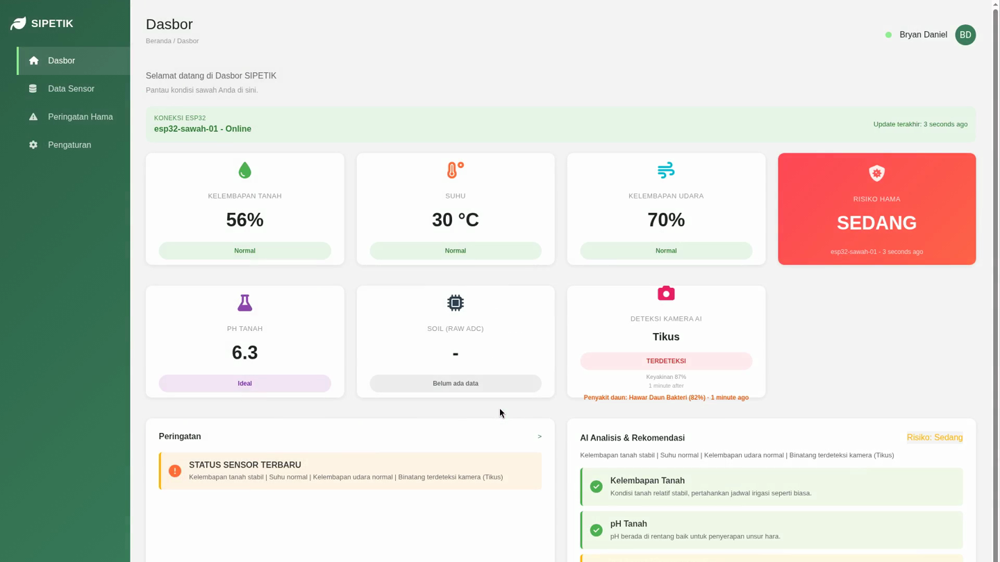
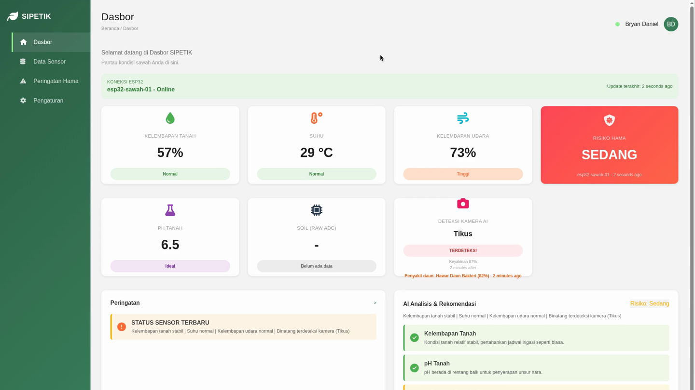
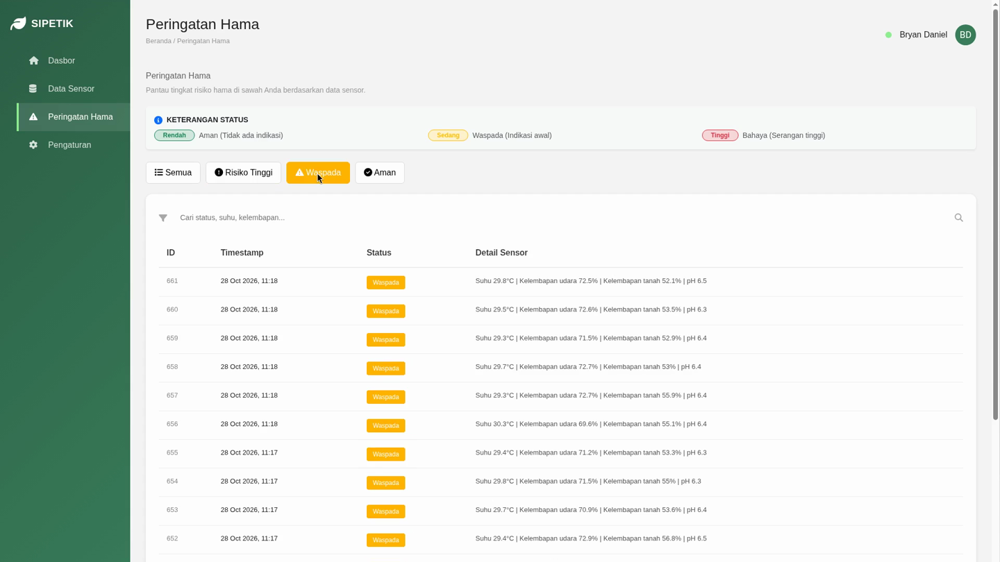
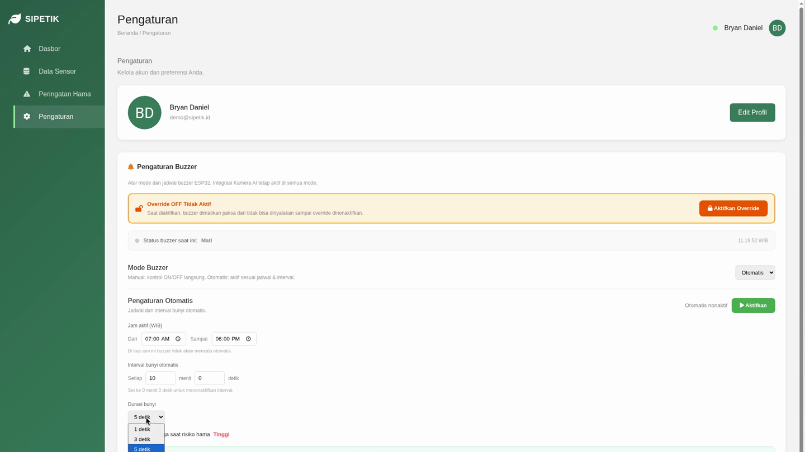
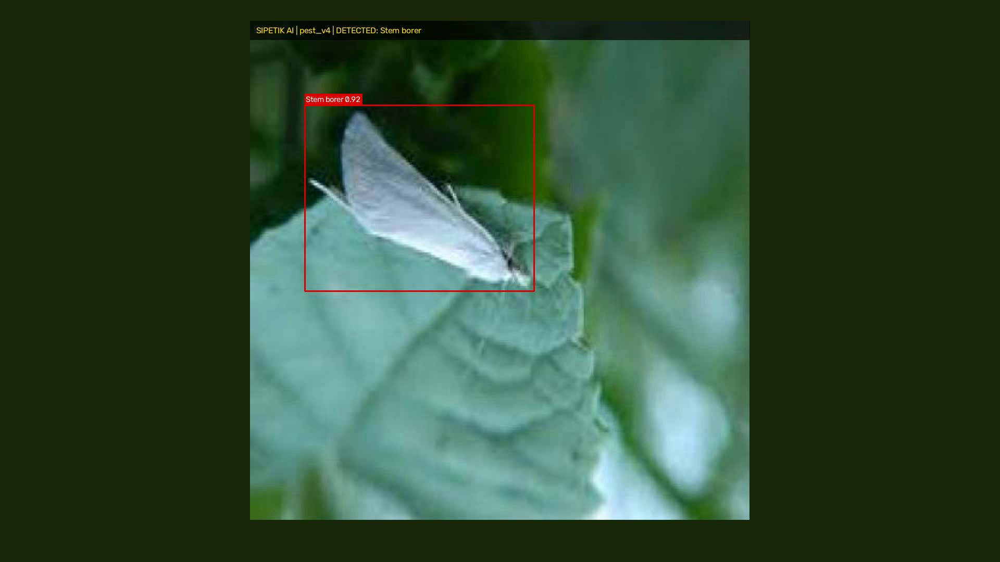
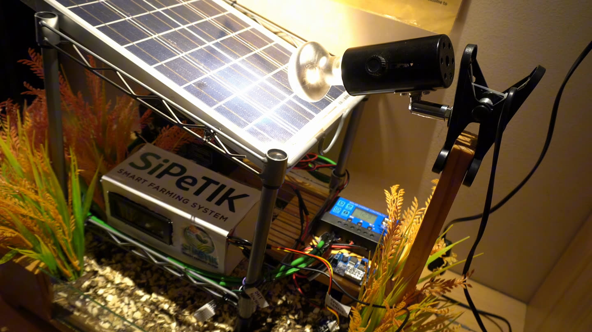
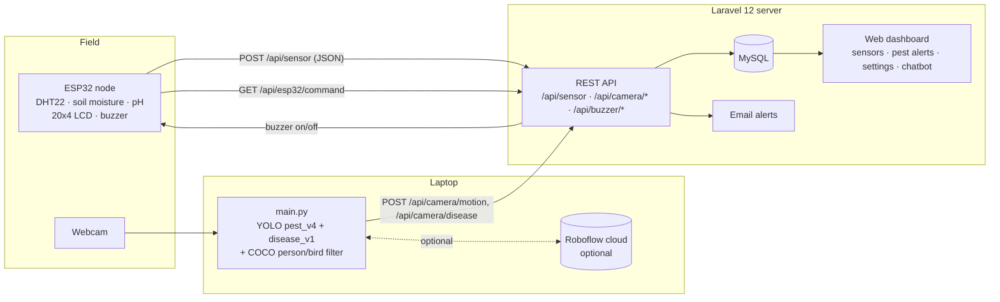

# SIPETIK — Smart Integrated Pest and Environment Tracking for Intelligent Crop-field

**An IoT + computer-vision early-warning system that watches Indonesian rice fields for pests and leaf diseases and alerts farmers before damage spreads.**

> Submitted to **FunDev International Competition 2026** — category *IoT & Web Development Integration*.
> Status: working prototype (field-tested 5 October 2026).

**Demo video:** [Watch the SIPETIK demo on Google Drive](https://drive.google.com/file/d/1lS4lYGVqsa08WzkBT2Kq8hAOb2abQZfz/view?usp=sharing)

## Screenshots

| Live dashboard | AI analysis & recommendations |
|---|---|
|  |  |
| **Pest alerts (Peringatan Hama)** | **Settings: buzzer mode & schedule** |
|  |  |
| **AI camera detection** | **Solar-powered field node** |
|  |  |

---

## 1. Problem

Rice (*padi*) is Indonesia's staple crop, and smallholder farmers lose harvests to pests such as brown planthopper (*wereng coklat*), rice bug (*walang sangit*), golden apple snail (*keong mas*), stem borers and rats. Most farmers find out by walking the field, often after an outbreak has already spread. Field conditions that favour pests (temperature, humidity, soil moisture, soil pH) are rarely measured at all.

## 2. Solution overview

SIPETIK combines three parts:

1. **Field sensor node (ESP32)** — reads air temperature and humidity, soil moisture and soil pH, shows them on a 20x4 LCD, sends them as JSON to the server every second, and drives an on-site buzzer on command.
2. **AI camera (Python + YOLO)** — a webcam watches the crop; a local YOLO model detects 10 rice pests and an optional second model recognises 6 rice leaf diseases. Humans and birds are filtered out so the buzzer does not sound at farmers.
3. **Web dashboard (Laravel)** — stores all readings and detections in MySQL, shows live sensor cards, pest-alert history, buzzer control, email notifications, and an assistant chatbot ("Tanya SIPETIK").

## 3. Features

- Live monitoring of temperature, air humidity, soil moisture and pH from the ESP32.
- Local pest detection with `pest_v4.pt` (10 classes), with automatic fallback to `pest_v3.pt`, then `best.pt` (rat) + `pest_v2.pt`.
- Optional leaf-disease detection with `disease_v1.pt`, checked every 2 seconds. Diseases raise a **dashboard warning only** (`/api/camera/disease`) and do not trigger the buzzer.
- Human/bird filter using a COCO `yolov8n.pt` model so people in the field don't set off alarms.
- Optional cloud models on Roboflow (armyworm / *ulat grayak*, golden apple snail) when `ROBOFLOW_API_KEY` is set, run in a background thread so the preview stays smooth.
- Buzzer control from the dashboard: override OFF, manual and automatic modes; the ESP32 polls `/api/esp32/command`.
- Email alerts when pest risk is high, with on/off toggle and a test email.
- Pest-alert history, sensor-data table with filters, login/registration and user profile.
- "Tanya SIPETIK" farmer assistant (`/api/assistant/ask`), backed by a configurable LLM provider.
- Camera heartbeat and status so the dashboard knows whether the camera is online.

## 4. Architecture



## 5. Detected classes

### Pests — `pest_v4.pt` (YOLO11s, 10 classes)

| ID | Model label | Indonesian | English |
|---|---|---|---|
| 0 | `wereng_coklat` | Wereng batang coklat | Brown planthopper |
| 1 | `walang_sangit` | Walang sangit | Rice bug |
| 2 | `keong_mas` | Keong mas | Golden apple snail |
| 3 | `wereng_hijau` | Wereng hijau | Green leafhopper |
| 4 | `penggulung_daun` | Penggulung daun | Rice leaf folder |
| 5 | `penggerek_batang` | Penggerek batang | Rice stem borer |
| 6 | `kepinding_hitam` | Kepinding hitam | Black rice bug |
| 7 | `belalang_padi` | Belalang padi | Rice grasshopper |
| 8 | `lalat_bibit` | Lalat bibit | Rice seedling fly / whorl maggot |
| 9 | `tikus` | Tikus | Rat |

Cloud (optional, Roboflow): *ulat grayak* (armyworm) and *keong mas*.

### Leaf diseases — `disease_v1.pt` (6 classes, warning only)

| ID | Model label | Indonesian | English |
|---|---|---|---|
| 0 | `blas_daun` | Blas daun | Leaf blast |
| 1 | `hawar_daun_bakteri` | Hawar daun bakteri | Bacterial leaf blight |
| 2 | `bercak_coklat` | Bercak coklat | Brown spot |
| 3 | `bercak_coklat_sempit` | Bercak coklat sempit | Narrow brown leaf spot |
| 4 | `hangus_daun` | Hangus daun | Leaf scald |
| 5 | `gosong_daun` | Gosong daun | Leaf smut |

## 6. Tech stack

| Layer | Technology |
|---|---|
| Backend | PHP 8.2+, Laravel 12 |
| Database | MySQL (e.g. via XAMPP) |
| Frontend | Blade, Tailwind CSS 4, Vite 7 |
| AI camera | Python 3, Ultralytics YOLO (YOLOv8 / YOLO11), OpenCV, ByteTrack (`lap`), Roboflow `inference-sdk` |
| Firmware | Arduino C++ for ESP32 (WiFi, HTTPClient, ArduinoJson, LiquidCrystal_I2C, DHT) |
| Training | Ultralytics on an NVIDIA RTX 5070 laptop GPU |

## 7. Hardware

| Component | Role | ESP32 pin |
|---|---|---|
| ESP32 dev board | Controller + WiFi | — |
| DHT22 | Air temperature & humidity | GPIO 14 |
| Capacitive soil-moisture sensor | Soil moisture (ADC) | GPIO 34 |
| Analog pH sensor | Soil pH (ADC) | GPIO 33 |
| Active buzzer | On-site pest alarm | GPIO 25 |
| 20x4 I2C LCD (0x27) | Local readout | SDA/SCL |
| USB webcam + laptop | AI camera | — |

## 8. Setup

### 8.1 Laravel dashboard

```bash
composer install
cp .env.example .env        # set DB_*, MAIL_*, ASSISTANT_PROVIDER / OPENAI_*, ROBOFLOW_API_KEY
php artisan key:generate
php artisan migrate
npm install
npm run build
php artisan serve --host=0.0.0.0 --port=8000
```

Start MySQL first. The full app (login, camera endpoints, assistant) is defined in `routes/web_with_api.php`; `routes/web.php` and `routes/api.php` hold a shorter version.

### 8.2 ESP32

1. Open `esp32_sipetik_dashboard.ino` in Arduino IDE with ESP32 board support.
2. Install libraries: ArduinoJson, LiquidCrystal_I2C, DHT sensor library.
3. Set your WiFi credentials and `SERVER_BASE` (the laptop's LAN IP, port 8000).
4. Flash, then open Serial Monitor — it prints the sensor and command URLs.

### 8.3 AI camera

```bash
pip install -r camera_requirements.txt
python main.py
# options, e.g.:
python main.py --server http://192.168.1.5:8000 --conf 0.65 --cooldown 10 --camera 0
```

Place `pest_v4.pt` (and optionally `disease_v1.pt`) next to `main.py`.

## 9. Model training

The `training/` folder contains the full pipeline:

- `download_datasets.py`, `build_dataset_v3.py`, `build_phone_dataset.py`, `build_disease_dataset.py` — collect and merge datasets, including "not a pest" images (people, faces, hands, diseased leaves, rice panicles) to reduce false alarms.
- `train.py`, `train_v3.py`, `train_disease.py` — training scripts; `data.yaml`, `data_v2.yaml` — dataset configs.
- `eval_disease.py`, `eval_false_positives.py`, `eval_phone.py`, `eval_video.py`, `test_image.py` — evaluation tools.
- `training/README.md` — dataset history, including the domain-gap fix (early data was dead insects on sticky traps; natural field photos were added).

**Recorded result — `pest_v2` (first 9-class model, YOLOv8n, 9,921 training images, 100 epochs, RTX 5070):** mAP50 **0.981** at epoch 100 (peak 0.983), mAP50-95 **0.676** on the validation set.
Training logs for `pest_v4` and `disease_v1` are not included in this repo, so no metrics are claimed for them here; see the field test below.

## 10. Field test (5 October 2026)

A scripted camera test (`SIPETIK_uji_kamera.csv`) played 38 segments in front of the webcam:

| Group | Segments | Correct |
|---|---|---|
| Pests (9 types) | 19 | 16 |
| Non-pest images (everyday photos, rice panicles) | 13 | 13 |
| Leaf diseases | 5 | 1 |
| Demo video without pests | 1 | 0 |
| **Total** | **38** | **30 (79%)** |

- Correct: brown planthopper, rice bug, golden apple snail, green leafhopper, leaf folder, stem borer, grasshopper, seedling fly; no false alarms on 13 non-pest images.
- Missed: black rice bug (very small in frame), and both rat segments.
- Diseases: only leaf scald produced a warning; the other four were missed.
- One false alarm (stem borer) on the demo video.

Next steps: more field footage of rats and tiny insects, and more disease training data.

## 11. Repository structure

```
app/                       Laravel controllers & models (sensor, buzzer, camera, notifications, assistant)
routes/                    web.php, api.php, web_with_api.php (full app)
resources/                 Blade views, CSS/JS
database/                  migrations
training/                  dataset builders, training & evaluation scripts
main.py                    AI camera
animal_detector.py         detector helper
camera_requirements.txt    Python dependencies for the camera
esp32_sipetik_dashboard.ino ESP32 firmware
MANUAL_BOOK.md             user manual (Indonesian)
*.pt                       model weights (pest_v4, pest_v3, pest_v2, best, disease_v1, yolov8n)
docs/screenshots/          dashboard and camera screenshots
archive/                   older presentation material and unused weights
```

## 12. Team — Universitas Pelita Harapan

| Name | Role / Program |
|---|---|
| Bryan Daniel Angelino | Team Lead — Information Systems |
| Alyssa Christiana Lin | Information Systems |
| Filbert Audric | Information Systems |

## 13. License

MIT — see [LICENSE](LICENSE).
